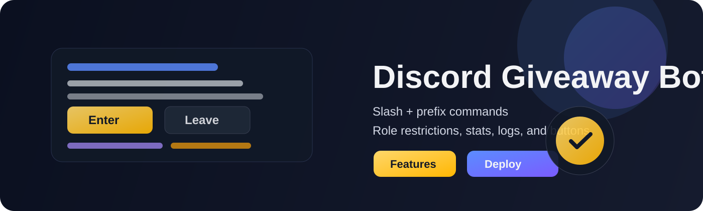

# Discord Giveaway Bot

<p align="center">
  
</p>

<p align="center">
  <a href="https://github.com/DJMooncake/discord-giveaway-bot/actions/workflows/build.yml">
    
  </a>
  
  
  
</p>

Author: DJMooncake

A full-featured TypeScript Discord giveaway bot with support for both slash commands and classic prefix commands.

## Overview

This project is built for running giveaways in Discord servers with a clean, reusable setup. It supports flexible timing, role-gated access, join/leave buttons, server-specific settings, and a wide range of giveaway management commands.

## Features

- Start giveaways with custom titles, winners, roles, and durations
- Flexible duration parsing from seconds to years: `s`, `m`, `h`, `d`, `y`
- Optional role requirement before joining
- Join and leave buttons on giveaway embeds
- List active giveaways
- End, cancel, reroll, and stats commands
- Configurable log channel for giveaway events
- Per-server prefix and auto-delete settings
- Works with both slash commands and prefix commands

## Screenshots

Add your screenshots here to showcase the bot in action.

```md


```

You can add images to an `assets/` folder and reference them here.

## How It Works

The bot keeps a lightweight in-memory registry of active giveaways and guild settings.

- Each giveaway stores its message ID, channel, guild, title, winner count, end time, and participants.
- When a giveaway starts, the bot sends an embed with join and leave buttons.
- Button clicks are validated for cooldowns, duplicate entries, and required roles.
- When the timer expires, the bot selects winners and posts the result to the giveaway thread or channel.
- Guild settings are tracked separately so prefixes, log channels, roles, and auto-delete states can vary per server.

## Quick Start

### 1. Install dependencies

```bash
npm install
```

### 2. Configure environment

Create a local `.env` file in the project root using the example file as a template:

```env
DISCORD_TOKEN=your_bot_token_here
DISCORD_CLIENT_ID=your_application_id_here
```

Important: this file is local-only and should never be committed to a public repository. The public repo includes `.env.example`, not a real `.env` with credentials. Anyone who wants to run the bot creates their own `.env` on their machine with their own token.

### 3. Run locally

```bash
npm run dev
```

### 4. Validate and build

```bash
npm run test
npm run build
```

For a production build:

```bash
npm start
```

## Discord Setup

1. Go to the Discord Developer Portal.
2. Create a new application.
3. Open the Bot section and create a bot.
4. Copy the bot token into `.env`.
5. Copy the Application ID into `.env`.
6. In OAuth2 > URL Generator, select:
   - `bot`
   - `applications.commands`
7. Invite the bot to your Discord server.

Example invite URL:

```text
https://discord.com/oauth2/authorize?client_id=YOUR_APPLICATION_ID&permissions=8&scope=bot%20applications.commands
```

## Commands

### Slash commands

- `/giveaway title:"Steam Key" duration:"1d 2h" winners:2`
- `/giveaway title:"Nitro" duration:"45m" winners:1 role:@Members`
- `/giveaway title:"Legendary Drop" duration:"1y 2d 3h 4m 5s" winners:3`
- `/setlogchannel channel:#giveaway-log`
- `/setgiveawayrole role:@VIP`
- `/cleargiveawayrole`
- `/setprefix prefix:!`
- `/setautodelete enabled:true`
- `/listgiveaways`
- `/cancelgiveaway messageid:1234567890`
- `/cancelallgiveaways`
- `/leavegiveaway messageid:1234567890`
- `/whoentered messageid:1234567890`
- `/giveawaystats`
- `/giveawaystats messageid:1234567890`
- `/endgiveaway messageid:1234567890`
- `/rerollgiveaway messageid:1234567890`

### Prefix commands

Default prefix: `!`

- `!giveaway 10m 2 Steam Key`
- `!giveaway 1d 4h 2 Nitro`
- `!setprefix ?`
- `!setautodelete true`
- `!listgiveaways`
- `!cancelgiveaway 1234567890`
- `!cancelallgiveaways`
- `!leavegiveaway 1234567890`
- `!whoentered 1234567890`
- `!giveawaystats`
- `!giveawaystats 1234567890`

## Duration Format

Examples:

- `30s`
- `45m`
- `2h`
- `1d 4h`
- `1y 2d 3h 4m 5s`

## Deployment Checklist

Before running the bot in production, confirm:

- [ ] Node.js 20+ is installed
- [ ] dependencies are installed with `npm install`
- [ ] a local `.env` file exists with valid Discord values
- [ ] the bot is invited to the target Discord server
- [ ] slash commands are enabled in the application
- [ ] your server has the required permission scopes
- [ ] you have reviewed log channel and role settings
- [ ] you have tested a giveaway in a dev server before production use

## Support

If you want to support this project, you can:

- star the repository
- share it with others
- contribute improvements
- open an issue for bugs or feature requests

## Deployment Notes

- Keep your real Discord token in a local `.env` file only.
- Do not commit secrets to Git.
- The repository is set up to ignore `.env` files by default.
- This project is suitable for running on a local machine, a VPS, or a hosted Node.js environment.

## Platform Startup Helpers

This repository includes starter scripts so it is easy to run on both Windows and Linux without needing to remember the exact command sequence.

### Windows

```bat
start.bat
```

### Linux / macOS

```bash
chmod +x start.sh
./start.sh
```

These wrappers run the environment check first and then launch the bot with the project’s normal startup path.

## Download / Release Flow

GitHub users can download the project in a few ways:

- clone the repository with Git
- download a zip archive from the repository page
- use a GitHub Release if you publish one later

For public distribution, the best approach is to publish a GitHub Release with packaged ZIP or TAR archives, rather than exposing a live `.env` file or bot token.

The bot token stays local to each user’s machine in their own `.env` file.

## License

This project is licensed under the MIT License.
